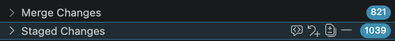
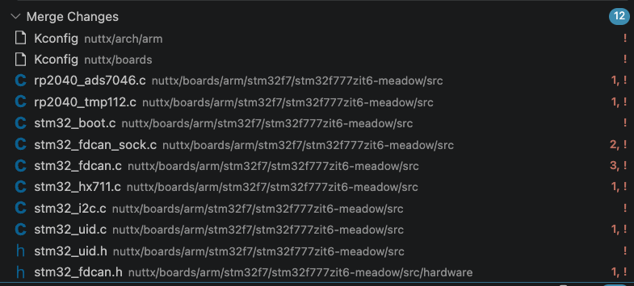
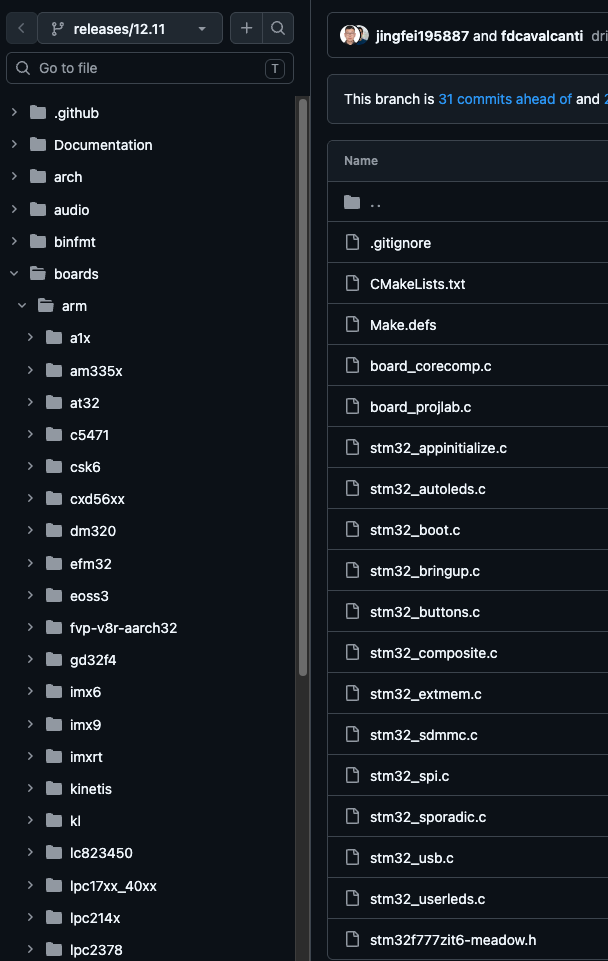

# Rebasing

The following notes discuss practical experience of rebasing NuttX OS and Apps into this repository.  The assumption is that we will be rebasing from release/12.10 to release/12.11.

## Directory Structure

The following directory structure is assumed:

```
OS/
├─ MainlineApps/
├─ Mainline/
├─ Rebase/
│  ├─ apps
│  ├─ nuttx
│  ├─ <other files>
```

The names of the _Mainline_, _MainlineApps_ and _Rebase_ directories can be changed if desired, just adjust the instructions to your needs.

## Prepare the Directories

The first step is to get the Mainline directories on the correct versions:

In the `Mainline` and `MainlineApps` perform the following:

```bash
git checkout releases/12.11
git reset --hard && git clean -dffx
```

The source code should now be on the release branch `releases/12.11 nuttx-12.11.0`

Next move to the `Rebase` directory.

```bash
git remote add local-nuttx ../Mainline
git checkout -b Merging12-11
git reset --hard && git clean -dffx
```

The Rebase repository should now be on the `Merging12-11` branch.

## Merging

Next, start the merge:

```bash
git subtree pull \
    --prefix=nuttx/ \
    local-nuttx \
    nuttx-12.11.0
```

At the end of this command in `Rebase`, we will usually have some staged files and some files requiring manual merge due to conflicting changes.

`MainlineApps` can complete the merge without intervention.

In Visual Studio Code the git extension will show something like the following:



This shows a large number of files requiring manual intervention.  The following command should remove any updates from `Mainline` that have been updated by us:

```bash
git status --short | grep "^DU" | grep -E "nuttx/(arch|boards)/" | awk '{print $2}' | xargs git rm
```

Following this command we will see something like:


The number of files requiring manual merge has been reduced dramatically.

## Quick Wins

There are certain directories that we rarely (if ever) change.  For these directories we can absorb the `Mainline` changes:

```bash
git checkout --theirs nuttx/Documentation
git add nuttx/Documentation
```

`nuttx/tools` is **not** one of these directories any more.  It now contains Wilderness Labs
additions and modifications (`build-globals.sh`, `Config.mk`, `nxstyle.c`,
`pynuttx/nxgdb/macros.py`, `pynuttx/nxgdb/debug.py`, and possibly others by the time you read
this) that must be preserved.  Blindly running `git checkout --theirs nuttx/tools` will silently
discard our changes.  Treat conflicts under `nuttx/tools` the same as any other manually-merged
directory: inspect each conflicting file and merge in the upstream changes by hand, keeping our
customizations. Run `git log -- nuttx/tools` in the current `Rebase` tree before merging to
confirm which files carry local changes, since this list will grow over time.

## Anomalies

Expanding the merge conflicts shows a number of files that will be taken from `Mainline` which have a conflict in the `Rebase` repository:



Comparing these to the online version of NuttX we see that these files are not in the online repository either:



The following command allows us to look at the files that have been added:

```bash
git status --short | grep "^UA" | grep "nuttx/boards/arm/stm32f7/stm32f777zit"

UA nuttx/boards/arm/stm32f7/stm32f777zit6-meadow/src/hardware/stm32_fdcan.h
UA nuttx/boards/arm/stm32f7/stm32f777zit6-meadow/src/rp2040_ads7046.c
UA nuttx/boards/arm/stm32f7/stm32f777zit6-meadow/src/rp2040_tmp112.c
UA nuttx/boards/arm/stm32f7/stm32f777zit6-meadow/src/stm32_fdcan.c
UA nuttx/boards/arm/stm32f7/stm32f777zit6-meadow/src/stm32_fdcan_sock.c
UA nuttx/boards/arm/stm32f7/stm32f777zit6-meadow/src/stm32_hx711.c
UA nuttx/boards/arm/stm32f7/stm32f777zit6-meadow/src/stm32_uid.c
UA nuttx/boards/arm/stm32f7/stm32f777zit6-meadow/src/stm32_uid.h
```

If the list looks to match the ones visible in Visual Studio then we can pipe the file names through to git and have them removed automatically:

```bash
git status --short | grep "^UA" | grep "nuttx/boards/arm/stm32f7/stm32f777zit" | awk '{print $2}' | xargs git rm
 
rm 'nuttx/boards/arm/stm32f7/stm32f777zit6-meadow/src/hardware/stm32_fdcan.h'
rm 'nuttx/boards/arm/stm32f7/stm32f777zit6-meadow/src/rp2040_ads7046.c'
rm 'nuttx/boards/arm/stm32f7/stm32f777zit6-meadow/src/rp2040_tmp112.c'
rm 'nuttx/boards/arm/stm32f7/stm32f777zit6-meadow/src/stm32_fdcan.c'
rm 'nuttx/boards/arm/stm32f7/stm32f777zit6-meadow/src/stm32_fdcan_sock.c'
rm 'nuttx/boards/arm/stm32f7/stm32f777zit6-meadow/src/stm32_hx711.c'
rm 'nuttx/boards/arm/stm32f7/stm32f777zit6-meadow/src/stm32_uid.c'
rm 'nuttx/boards/arm/stm32f7/stm32f777zit6-meadow/src/stm32_uid.h'
```

## Manual Changes

Some files will still require manual intervention, particularly three `kconfig` files.  These files have manual changes that remove unused boards from the `Rebase` repository.  The following files need careful intervention:

```bash
nuttx/arch/arm
nuttx/boards
nuttx
```

## Build

Final step before merge is to build the system with the command `build.sh --clean --force`.  Make a note of the build number:

`Build of version 1.99.0.16254 (0abdfc3d:merging12-11) finished at 08:25:39`

Now flash to the board and execute `meadow device info`:

```
Getting device info...
Meadow by Wilderness Labs
Board Information 
    Model: F7Micro
    Hardware version: F7CoreComputeV2
    Device name: MeadowF7

Hardware Information 
    Processor type: STM32F777IIK6
    ID: 35-00-28-00-07-51-38-34-35-31-38-33
    Serial number: 336031743438
    Coprocessor type: ESP32

Firmware Versions 
    OS: 1.99.0.16254
```

The firmware version number should match the build information from the build process.

## Check Repository

The `alphaTooling` directory contains a Python script to perform a final check on the files in the `Rebase` repository by comparing them to the files in the `Mainline` repository.

```
./check_repository ../../Mainline

Source : <root directory>/OS/Mainline
Local  : <root directory>/OS/Rebase/nuttx

Files have other differences (31):
  arch/Kconfig
  arch/arm/Kconfig
  arch/arm/src/stm32f7/hardware/stm32f76xx77xx_memorymap.h
  arch/arm/src/stm32f7/stm32_ethernet.c
  arch/arm/src/stm32f7/stm32_fmc.h
  boards/Kconfig
  boards/arm/stm32f7/stm32f777zit6-meadow/Kconfig
  boards/arm/stm32f7/stm32f777zit6-meadow/configs/meadow_os/defconfig
  boards/arm/stm32f7/stm32f777zit6-meadow/include/board.h
  boards/arm/stm32f7/stm32f777zit6-meadow/kernel/Makefile
  boards/arm/stm32f7/stm32f777zit6-meadow/kernel/stm32_userspace.c
  boards/arm/stm32f7/stm32f777zit6-meadow/scripts/Make.defs
  boards/arm/stm32f7/stm32f777zit6-meadow/scripts/kernel-space.ld
  boards/arm/stm32f7/stm32f777zit6-meadow/scripts/ld.script
  boards/arm/stm32f7/stm32f777zit6-meadow/scripts/memory.ld
  boards/arm/stm32f7/stm32f777zit6-meadow/scripts/user-space.ld
  boards/arm/stm32f7/stm32f777zit6-meadow/src/Make.defs
  boards/arm/stm32f7/stm32f777zit6-meadow/src/stm32_appinitialize.c
  boards/arm/stm32f7/stm32f777zit6-meadow/src/stm32_autoleds.c
  boards/arm/stm32f7/stm32f777zit6-meadow/src/stm32_boot.c
  boards/arm/stm32f7/stm32f777zit6-meadow/src/stm32_bringup.c
  boards/arm/stm32f7/stm32f777zit6-meadow/src/stm32_buttons.c
  boards/arm/stm32f7/stm32f777zit6-meadow/src/stm32_extmem.c
  boards/arm/stm32f7/stm32f777zit6-meadow/src/stm32_spi.c
  boards/arm/stm32f7/stm32f777zit6-meadow/src/stm32_sporadic.c
  boards/arm/stm32f7/stm32f777zit6-meadow/src/stm32_usb.c
  boards/arm/stm32f7/stm32f777zit6-meadow/src/stm32_userleds.c
  include/sys/syscall_lookup.h
  mm/Makefile
  net/socket/socket.c
  syscall/syscall.csv
  ```

  The comparison uses the `Rebase` repository as the source of truth and performs a comparison of the files.  Any differences should be reported here.  It will then be necessary to confirm the differences and verify that they are expected.
  