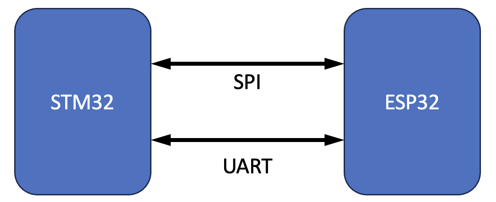
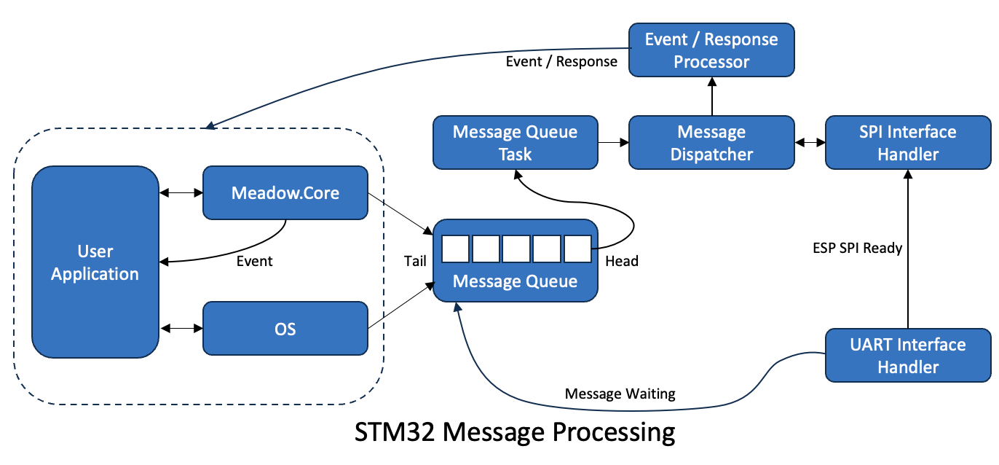

# Communications Overview

The `MeadowComms` application is a FreeRTOS application using ESP-IDF.  The system is designed to use the SPI and UART interfaces for communication and control.  The majority of the messages are requests from the application running on the STM32 along with any responses.  There are a number of Events that can also be generated by the ESP32.

The requests / responses and events will be serviced (or generated in the case of Events) through the following interfaces:

* WiFi
* Bluetooth
* System (e.g. configuration) requests

For a detailed view of how these components are organized, see [Project Structure](ProjectStructure.md).

The SPI interface is bidirectional with requests being generated by the STM32 application with responses and event messages generated by the ESP32.

The STM32 acts as a SPI controller and the ESP32 acts as a SPI peripheral device.  This means that although the SPI interface is bidirectional all of the communication between the two devices is under the control of the STM32.

A UART interface is used by the two microcontrollers to send control messages between the two devices.  The messages here are short and only a few characters in length.  Typical messages are:

* ESP32 has a messages waiting for delivery to the STM32 (MW)
* ESP32 SPI interface is ready (SIR)

The SPI interface is used as the primary method of delivering data for the various services offered by the ESP32.  This interface is used for service messages as it can run at a higher speed that the UART interface.

## Multithreading

The managed application and the operating system on the STM32 both have the capability of running multiple threads with each thread being able to generate requests for the ESP32.  The asynchronous nature of these requests poses a problem for the communication system as the SPI bus is synchronous by nature.

A further complication is that FreeRTOS is also a multithreaded system.  This capability is utilised on the ESP32 in order to improve the performance of the request processing with multiple requests being processed concurrently.

As a result, the order of the requests and the responses to the requests should be considered to be non-deterministic.  It is necessary for the messaging system to take this behaviour into consideration in order to ensure that responses are matched to the original request.

## STM32 SPI Communication and Message Processing

The STM32 deals with requests from NuttX and Meadow.Core using through a number of tasks and message queues.

A .NET application can make a direct request to the ESP32 for activities such as starting the WiFi network, scanning for a list of access points / networks etc.  

The second way an application can make a request to the ESP32 is indirectly through NuttX.  An example of this is the `Socket.Connect` method which calls the low level OS method `connect`.  The `connect` method in NuttX then delegates this request to the ESP32.

It is important to note that requests can be blocking or non-blocking.  This allows support for say a network request (`connect` in the above example) which according to the POSIX definition should return a result code as well as supporting actions such as connecting to an access point.

It is also necessary for the system to support Events that may be generated by the ESP32.  Examples of events are:

* Network disconnection
* Changes to Bluetooth characteristic values

These Events are generated by the ESP32 in response to the local environment or from the actions of client applications connected to the ESP32.

The high level view of the messaging system running on the STM32 is as follows:

All of the requests to the ESP32 and the events generated by the ESP32 create a [message](MessageFormat.md) holding the request, event or response information.

The message is first added to an outbound message queue.  The type of request is then examined.  For a non-blocking request the system simply returns from the request and the application can then continue.

For a blocking request, the message holding the request is placed in a linked list of messages waiting for responses.  The system then creates a semaphore and takes the semaphore.  This effectively prevents the application from continuing on the current thread until the response returns.

Messages are then picked up by the _Message Queue Task_.

The system has the capability of sending up to 16K of data per message.  Any large messages must take into consideration the fact that the ESP32 can only send and receive up to 4090 bytes in a single SPI transfer.  In order to achieve this any large messages are broken down into smaller messages and then reassembled as needed.

### Message Queue Task

The Message Queue Task monitors the outbound message queue and waits until there are one or more messages to be processed.  When a message arrives, the task hands the message over to the message dispatcher which then deals with the process of sending the message, processing the handshaking and any message responses.

Sending a message is a multistage process:

1. Send message header and the initial data packet if there is any data to send
2. Receive header acknowledgement / negative acknowledgement
3. Send any further data packets (for large messages)
4. Receive header and payload acknowledgement / negative acknowledgement
5. Repeat from 3 until all of the data associated with the message has been sent.

The full communication process is described in detail in the [SPI Protocol Overview](SPIProtocolOverview.md) page.

## ESP32 SPI Communication and Message Processing

The ESP32 uses FreeRTOS as its operating system.  The combination of FreeRTOS and ESP-IDF allows the creation of a multithreaded system (FreeRTOS) capable of accessing the hardware on the ESP32 (through ESP-IDF).

Pictorially, the system looks as follows:

At startup, the application on the ESP32 starts a task to handle the SPI data packet transfer.  The SPI task has a single responsibility, to transfer data between the two systems and to pass on valid messages to the _Message Dispatcher_.  Invalid messages (CRC failures etc.) are dealt with transparently to the remainder of the system.

The _Message Dispatcher_ takes the incoming message and uses the _Interface_ parameter to determine which of the various systems (WiFi, Bluetooth etc.) the message is destined for. It then places the message into the message queue assigned to the specific subsystem.

The _Message Dispatcher_ also contains a message queue for responses or messages / Events destined for the STM32.

## Anatomy of a Subsystem

Each of the subsystems on the ESP32 is responsible for processing the requests from the STM32 and where necessary generating responses for the STM32.

Each system is constructed with knowledge of the _Message Dispatcher_ and the hardware it can interact with.  The system comprises of a message queue taking incoming requests and a task that monitors the message queue for requests.  The task waits on the message queue until a request is received and then processes the request.  If a response is generated it is then added to a queue of messages waiting to be sent to the STM32.  The response will be picked up by the _Message Dispatcher_ at some point in the future.

## Sending Data or Responses to the STM32

As noted earlier, the STM32 is the communication system controller.  This means that the ESP32 cannot initiate communication, it can only respond to requests from the STM32.  The ESP32 indicates that it has data ready for collection by sending a message over the UART interface.

The STM32 UART handler will pick up this message and add a _Send Response_ message to the message queue.  This will be picked up by the _Message Queue Task_ on the STM32 as normal.

### _Send Response_ Message

The _Send Response_ message is a special message for the both the STM32 and the ESP32.

For the STM32 it indicates that the message should be sent to the ESP32 (to request the response) and the STM32 then enters the process of requesting the response message from the ESP32.

In the case of a valid response, the STM32 will request the data from the ESP32 and then process it accordingly.  The responses fall into one of three categories:

* Response to a request
* Event messages

#### Message Response

When the STM32 receives a response to say a `Socket.Connect` request, it will use the _MessageId_ field in the header and the linked list (for blocking messages discussed above) to identify the message that generated the request.  The response will be attached to the original request and a post to the semaphore with then release the originating thread to run once again.

#### Events

The STM32 uses the _Interface_ property of the message along with the _Function_ property to identify which interrupt has been generated.  The appropriate C method is called on the STM32 if a match is found.

See the [Event Overview](EventProcessing.md) for more information on how to set this up.
