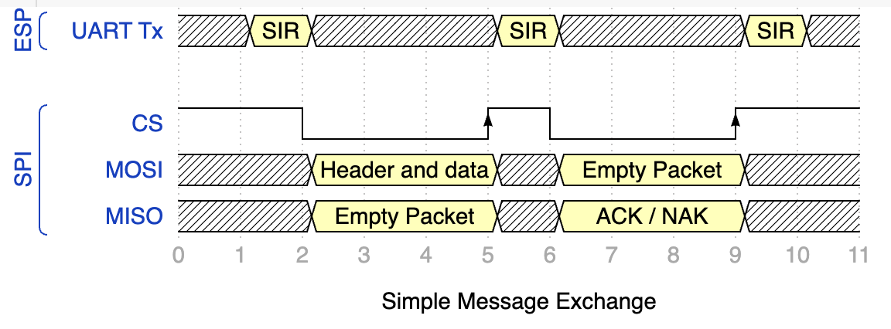
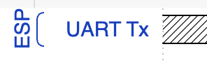
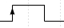
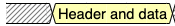
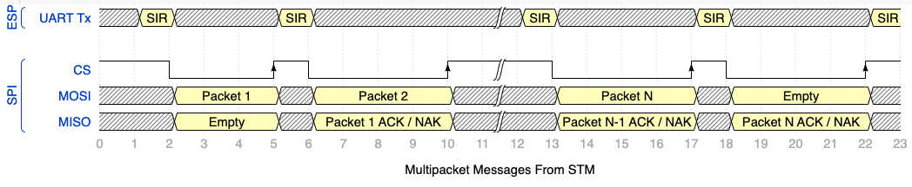
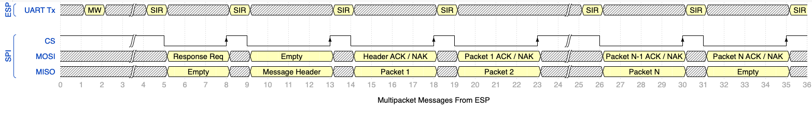

## SPI Communication Protocol Overview

### Terms and Diagram Key

The diagram below illustrates the signals during a full message exchange:

The following sections explain the various components of the diagram.

#### Signal Names and Source

The left hand side of the diagram show the names of the signals grouped by the source of the signal.

So the above indicates that the data will be transmitted over UART from the ESP32 to the STM32.

#### Interrupt

An interrupt signal is indicated by an arrow on the active edge of the signal.  So the following shows a pulse where the interrupt is generated on the rising edge of the pulse, no interrupt is generated on the falling edge:

#### Data Packet

Data packets are transmitted on the MOSI and MISO lines of the SPI bus.  The multiple transitions are are shown as follows:

The grey hatched area represents a period of time where the state of the signal lines does not matter as it is not being used.

The yellow named ares represent a period of time where data is present.

#### Time Markers

The lower part of the diagram shows the step markers used to reference the various stages of the data transfer:

### Control Signals

The ESP32 uses a UART to send control signals to the STM32.  These signals are simple text messages and each signal starts with *+++*.  The following signals are recognised by the STM32:

* +++RST,*code*
* +++MW
* +++SIR

Each control signal must be on a new line and must be the only data on the line.

#### +++RST,*code* - ESP32 Reset

This signal indicates that the ESP32 has reset and the reason for the reset is indicated by *code*.

#### +++MW - Message Waiting

The ESP has generated a message for the STM32.

#### +++SIR - SPI Interface Ready

The SPI interface on the ESP32 is ready for data transmission.  This signal is needed as there is a short delay between the CS line dropping to 0 and the ESP being able to receive data.

The three *+++* markers will be assumed to be present in the remainder of this document.
### Constraints

The system is configured with the STM32 acting as SPI master with the ESP32 acting as the slave device.  This means that all communication must be initiated by the STM32.

The ESP32 has a limit on the amount of data that can be transmitted in a single SPI transaction.  This restriction is due to a hardware bug in the silicon.  Transactions are restricted to 4092 bytes.

The hardware restriction along with the requirement to add information to the messages (see below) further reduces the maximum amount of data that can be transmitted in a single packet.

## Message Format

Messages between the two microcontrollers are broken up in to packets.  This allows the system to transfer messages greater than 4092 bytes.  The messages are broken down on the <i>sending</i> device and reassembled on the receiving device.

Internally, the data to be sent between the two microcontrollers is composed of a message header and the actual data to be processed.  The header allows the originating part of the system to be identified so the requests and the responses can be tied together.

So a request is comprised of a <i>header</i> and a <i>payload</i>.  The header identifies the request type and the originator.  The payload contains the data to be processed.

Messages are assigned a <i>message id</i> allowing the request and the response to be associated with each other.

## Message Storage and Processing

Messages can originate from a number of sources seemingly simultaneously as the user application and the operating system support multiple threads.  The use of a single SPI bus for transmission of messages restricts the system to processing one message at a time.  This is achieved by placing the messages generated into a NuttX [named message queue](https://nuttx.apache.org/docs/latest/reference/user/04_message_queue.html).

Any messages that require a response are placed in a linked list after the request has been sent to the ESP32.  Messages not requiring a response are discarded.

On receipt of a response, the linked list is searched for a message containing the message ID in the response.  If a message is located then the response is processed and the results returned to the originator.  If the message cannot be located then message is discarded.

It is also possible for a message to originate from the ESP32.  These messages have the top bit of the message ID set to 0 (messages originating from the STM32 have the top bit set to 1).  In this case the linked list is not searched and the message is processed immediately.

## Message from the STM32 to the ESP32

Messages originating on the STM32 are retrieved from the message queue and sent to the ESP32 in one or more packets.  Small messages will only require a single packet, larger messages will require a number of packets.  Each request is assigned a message ID prior to transmission.

The general process is as follows:

The key stages of the process are discussed below.

### Time 0 - Wait for the ESP32 SPI to be Ready

The STM32 assembles the first (and possibly only) packet and places it into the SPI Tx buffer.  It then waits for the ESP32 to indicate that the SPI interface is ready to receive data.

### Time 1 - STM32 Transmits Packet 1

The ESP32 sends the *SIR* message over UART to the STM32.

### Time 2 - SPI Transmission

The STM32 performs a conventional data transmission to the ESP32:

* *CS* line is drops from high to low
* Data is exchanged between the two chips
* *CS* line is raised from low to high (Time 5)

### Time 5 - ESP32 Processes Data

The ESP32 checks the contents of the packet to verify the integrity of the data.  If the data is good the ESP will start to allocate memory for the message and copy the data from the first packet into the memory allocated.

If the packet indicates that this is a message requiring a single packet then the process moves on to Time 18.

The ESP32 creates an ACK or a NAK message depending upon the integrity of the packet received.  This message is put into the Tx buffer ready for the STM32.

The ESP32 sends the *SIR* control message over UART to the STM32.

### Time 6 - STM32 Transmits Packet 2

The STM32 assembles the next packet of data and places this in the Tx buffer.  This packet is then sent to the ESP32 using the same process as Time 1 above.

The ACK / NAK packet from the ESP32 is then checked.

* ACK - the process described from Time 1 through Time 5 are repeated until we reach the last packet.
* NAK - The message is put back in the message queue and the transfer is aborted.

### Time 10 - Packet 2 Transmission Complete

The actions at this stage are pretty much the same as Time 5 with the addition of a check on the ESP32.  It is now necessary to check not only the integrity of the data but also the message ID.  A NAK is generated if the message IDs do not match and any resources allocated are released.

### Time 18 - ESP32 Acknowledges the Final Packet

This step follows the ACK / NAK process as discussed previously with two small differences:

* The STM32 sends an empty buffer large enough to hold a header.  This is enough to allow the transmission of the ACK / NAK.
* ACK - The message is transferred to the appropriate subsystem (WiFi etc.) for processing.
* If the message is blocking (i.e. requiring a response) then the STM32 places the message in the linked list containing all of the messages that require a response.

## Message from the ESP32 to the STM32

The transmission of messages from the ESP32 to the STM32 is performed under the control of the STM32 and follows a similar transmission, ACK / NAK process as for the messages from the STM32 to the ESP32 with a few small differences.

* The STM32 must ask the ESP32 for information about the message (size etc)
* The ESP32 cannot control the process and so uses the *MW* UART message to indicate that there is a message waiting for transmission
* The roles of packet generation and ACK / NAK are reversed

The process looks like this:

### Time 1 - ESP32 Indicates that a Message is Waiting

The ESP32 sends the *MW* UART message to the STM32.  The STM32 places a special <i>send response</i> message into the message queue holding messages ready for transmission to the ESP32.

The message processing proceeds as normal with the STM32 retrieving messages from the queue and processing them one by one.  At some point in time the STM32 will retrieve the <i>send response</i> message from the queue.

### Time 5 - *Send Response* Message Retrieved

The STM32 places the send response message in to the Tx buffer and sends the message to the ESP32 following the transmission process discussed in the previous section <i>Message from the STM32 to the ESP32</i>.

### Time 8 - Send Message Transmission Complete

The ESP32 will put together an ACK (or NAK) for the STM32 and put this in the Tx buffer.

If the message is an ACK message then ESP32 will retrieve the first message ready to be sent to the STM32 and put details of the message (ID and size) into the ACK message.

The ESP will then send the *SIR* message over UART to indicate to the STM32 that the response is ready to be sent.

### Time 9 Through 13  - Sending Header

The STM32 will retrieve the ACK / NAK (plus header data for ACK) from the ESP32

### Time 13 - Sending Header Complete

It will perform the integrity checks on the message and put together an ACK / NAK message in the Tx buffer.  The STM32 will also calculate the packet size for the first packet to be retrieved.

* ACK - Use the message size to get calculate the optimal packet size
* NAK - Packet size is one headers worth of data.  The Send Response message will be put back on the message queue to be processed later.

The ESP32 will place a full packet of data into the Tx buffer ready for the STM32.  It will send the *SIR* message over UART once the data is in the buffer.

### Time 19 through 31 - Retrieve Packet 1

The STM32 retrieves a full packet of data from the ESP32.  The retrieval of the packet of data also sends the ACK / NAK to the ESP32.

The ESP32 checks the integrity of the packet and then checks if the message is an ACK or a NAK:

* ACK - Move on the the next packet
* NAK - Put the message to be sent to the STM32 back in the message queue

This process is pretty much the same as sending a message from the STM32 with the only difference being the ESP32 is sending data and the STM32 is generating ACK/NAK responses.

### Step 28 - Final Packet Acknowledgement

The process oof sending packets continues to the last packet.  At this point the STM32 puts together the ACK / NAK message and sends this to the ESP32.

* ACK - ESP32 frees any resources consumed by the message.  The STM32 processes the response sending the data to the appropriate location.
* NAK - The message is put back in the queue of messages waiting to be sent to the STM32.
